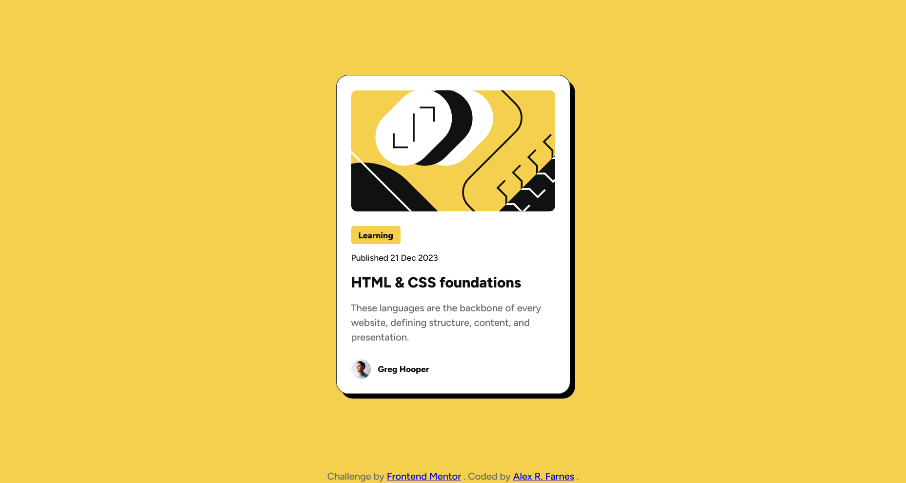
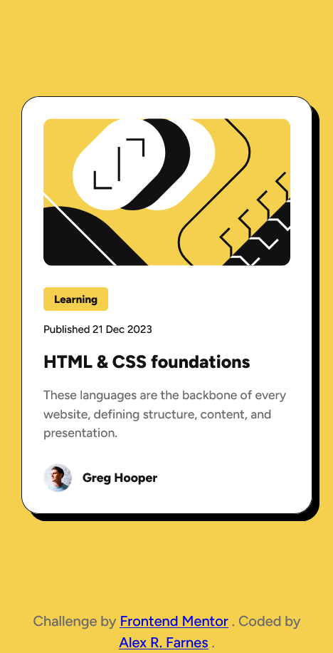

# Frontend Mentor - Blog preview card solution

This is a solution to the [Blog preview card challenge on Frontend Mentor](https://www.frontendmentor.io/challenges/blog-preview-card-ckPaj01IcS). Frontend Mentor challenges help you improve your coding skills by building realistic projects.

## Table of contents

- [Frontend Mentor - Blog preview card solution](#frontend-mentor---blog-preview-card-solution)
  - [Table of contents](#table-of-contents)
  - [Overview](#overview)
    - [The challenge](#the-challenge)
    - [Screenshot](#screenshot)
    - [Links](#links)
  - [My process](#my-process)
    - [Built with](#built-with)
    - [What I learned](#what-i-learned)
    - [Continued development](#continued-development)
  - [Author](#author)

## Overview

### The challenge

Users should be able to:

- See hover and focus states for all interactive elements on the page

### Screenshot

### Links

- Solution URL: [https://github.com/AlexRFarnes/blog-preview-card](https://github.com/AlexRFarnes/blog-preview-card)
- Live Site URL: [https://alexrfarnes.github.io/blog-preview-card](https://alexrfarnes.github.io/blog-preview-card)

## My process

### Built with

- Semantic HTML5 markup
- CSS custom properties
- Flexbox
- CSS Grid
- Mobile-first workflow

### What I learned

For this challenge I wanted to practice the use of Flexbox and reinforce how to properly structure a css file. I used CSS Grid on the body with two rows, one using `1fr` and the other with `auto`. This allows to put the attribution all the way to the bottom of the page and give all the remaining space to the card component. Flex was used in the card component with a fixed gap because the space is even between the three main sections of the card.

### Continued development

I want to keep working with CSS custom properties and combine CSS grid and flexbox to create more complex layouts.

## Author

- Website - [Alex R. Farnes](https://www.alexrfarnes.dev/) (🚧 site in construction)
- Frontend Mentor - [@AlexRFarnes](https://www.frontendmentor.io/profile/AlexRFarnes)
- LinkedIn - [@alexrfarnes](https://www.linkedin.com/in/alexrfarnes)
